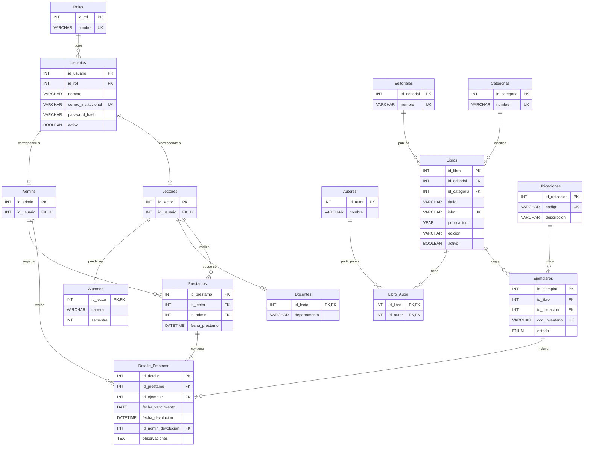

# BiblioApp

**Integrantes:**

- 24410172 - Miguel Ángel Ramírez Francisco
- 24410479 - Rocío Jaqueline Bordier Flores
- 24410663 - Axel Rodrigo Cisneros Cano

---

## 1. Idea General

BiblioApp es una aplicación web para administrar el catálogo, libros y  préstamos de una biblioteca académica. Está dirigida al personal de la biblioteca, alumnos y docentes.

Se ha detectado una dificultad para mantener un registro centralizado y actualizado. Algunos procesos aún se realizan mediante archivos separados, bases desactualizadas o fuera del acceso en línea útil hoy en día.

El objetivo del sistema es centralizar la información en una base de datos MySQL, facilitar el registro de préstamos y devoluciones y generar reportes que ayuden al personal a mantener un mejor control de la biblioteca.

Los alumnos y maestros registrarán su identificador institucional que permitirá distinguir su perfil dentro del sistema y podrán consultar sus préstamos e historial.

### 1.1 Alcance del Sistema
- Registrar y autenticar cuentas:
    - Administradores (personal)
    - Lectores (alumnos y maestros)
- Administrar la información de los libros: autores, editoriales, categorías, ubicaciones y ejemplares físicos.
- Consultar el catálogo y disponibilidad de los ejemplares.
- Registrar préstamos y devoluciones.
- Consultar préstamos e historial personal.
- Generar reportes parametrizables.

### 1.2 Delimitaciones
El sistema no incluirá: 
- Reservas 
- Renovaciones
- Multas o cobros
- Compras a proveedores
- Préstamos interbibliotecarios
- Libros digitales
- Notificaciones automáticas
- Aplicación móvil nativa.

Los préstamos serán registrados por el administrador durante la entrega presencial. No habrá autorregistro de cuentas.

Las fechas de vencimiento se establecerán al registrar cada préstamo. No se implementarán políticas establecidas por la institución.

## 2. Descripción de Tablas
Se integra la siguiente base de datos relacional compuesta por 14 tablas, normalizada hasta la Tercera Forma Normal (3FN):

| Tabla | Descripción y datos principales |
| --- | --- |
| `Roles` | Define el tipo de cuenta y permisos: Administrador y Lector. Contiene identificador y nombre único del rol. |
| `Usuarios` | Almacena nombre completo, correo institucional, hash de contraseña, estado activo/inactivo y referencia al rol. |
| `Admins` | Contiene la información específica del personal encargado de administrar la biblioteca. |
| `Lectores` | Identifica a los usuarios que pueden recibir préstamos. Cada lector se asocia con una cuenta única mediante `id_usuario`. |
| `Alumnos` | Extiende el perfil del lector con atributos de alumnos. `id_lector` será clave primaria y foránea. |
| `Docentes` | Extiende el perfil del lector con atributos de docentes. `id_lector` será clave primaria y foránea. |
| `Editoriales` | Registra las editoriales relacionadas con los libros del catálogo. |
| `Categorias` | Registra la clasificación principal de los libros. |
| `Autores` | Almacena los nombres de los autores que participan en las obras del catálogo. |
| `Libros` | Registra título, ISBN, año de publicación, edición, editorial, categoría y estado activo/inactivo. Cada registro representa una edición bibliográfica. |
| `Libro_Autor` | Auxiliar en la relación de muchos a muchos entre libros y autores. Su clave primaria compuesta evita repetir la misma asociación. |
| `Ubicaciones` | Registra los códigos y descripciones de estantes o secciones de la biblioteca. |
| `Ejemplares` | Registra cada copia física con código de inventario único, libro, ubicación y condición operativa: habilitado, mantenimiento o baja. |
| `Prestamos` | Almacena el lector, el administrador responsable del registro y la fecha y hora de la operación. |
| `Detalle_Prestamo` | Relaciona cada préstamo con sus ejemplares e incluye fecha de vencimiento, fecha y hora de devolución, administrador que recibe la devolución y observaciones. |

### 2.1 Diagrama de Base de Datos
El siguiente diagrama muestra las claves y relaciones principales.

**Figura 1**. *Diagrama Entidad-Relación de BiblioApp*

[Estilo alterno](./diagramaER.svg)

#### Restricciones

* Tabla **Admins**:
    * id_rol = 1. Solo podrán registrarse los usuarios cuyo id_rol sea igual a 1, correspondiente al rol de admin.
* Tabla **Detalle_Prestamo**:
    * Las fechas de devolución y el administrador que recibe se mantendrán nulos mientras el ejemplar no haya sido devuelto.

## 3. Tipos de Usuario (Roles)

BiblioApp manejará dos roles de acceso: Administrador y Lector. El rol Lector se especializa en dos tipos de perfil: Alumno y Maestro.

| Rol               | Acciones principales                                                                                                                                                                                                                                                              |
| ----------------- | --------------------------------------------------------------------------------------------------------------------------------------------------------------------------------------------------------------------------------------------------------------------------------- |
| **Administrador** | Iniciar sesión; administrar usuarios, lectores y cuentas; gestionar libros, autores, editoriales, categorías, ubicaciones y ejemplares; registrar préstamos y devoluciones; consultar la disponibilidad de ejemplares; consultar historiales; y generar reportes parametrizables. |
| **Alumno**        | Iniciar sesión con su correo institucional; consultar el catálogo de libros; consultar la disponibilidad de ejemplares; consultar sus préstamos activos y su historial de préstamos y devoluciones.                                                                        |
| **Docente**       | Iniciar sesión con su correo institucional; consultar el catálogo de libros; consultar la disponibilidad de ejemplares; consultar sus préstamos activos y su historial de préstamos y devoluciones.                                                                        |

Alumnos y docentes se diferencian por la información específica almacenada en sus perfiles.

Los préstamos y devoluciones serán gestionados por el **Administrador**, por lo que los alumnos y maestros no podrán registrar directamente estas operaciones.

## 4. Arquitectura
El sistema será desarrollado como una aplicación web, por lo que los usuarios podrán acceder mediante un navegador web sin necesidad de instalar una aplicación nativa en cada equipo.

Las tecnologías principales serán:

* **Frontend**: **HTML y CSS** para la creación de la interfaz y la interacción con el usuario.
* **Backend**: **PHP**, encargado de procesar las solicitudes, aplicar las reglas del sistema y comunicarse con la base de datos.
* **Servidor web**: **Apache**, encargado de recibir las solicitudes HTTP/HTTPS y servir la aplicación.
* **Base de datos**: **MySQL**, utilizada para almacenar y administrar la información de usuarios, lectores, libros, ejemplares, préstamos y devoluciones.
* **Entorno de desarrollo**: **Visual Studio Code** como editor de código y un entorno local basado en Apache, PHP y MySQL para el desarrollo y las pruebas del sistema.

### Módulos del Sistema

BiblioApp estará segmentado en los siguientes módulos:

| Módulo                  | Función principal                                                                                 |
| ----------------------- | ------------------------------------------------------------------------------------------------- |
| **Autenticación**       | Permitir el inicio de sesión y controlar el acceso según el rol del usuario.                      |
| **Usuarios y lectores** | Administrar las cuentas de usuarios, administradores, alumnos y maestros.                         |
| **Catálogo**            | Gestionar libros, autores, editoriales y categorías.                                              |
| **Ejemplares**          | Registrar las copias físicas, su ubicación, código de inventario y condición operativa.           |
| **Préstamos**           | Registrar los préstamos realizados por alumnos y maestros.                                        |
| **Devoluciones**        | Registrar la devolución de ejemplares, la fecha y hora y el administrador que recibe el material. |
| **Consultas**           | Permitir consultar el catálogo, disponibilidad, préstamos e historial personal.                   |
| **Reportes**            | Generar reportes parametrizables sobre libros, ejemplares, préstamos, devoluciones y usuarios.    |

## 5. Reportes
Los cuatro reportes serán generados por el administrador en formato PDF. Cada documento incluirá el nombre del sistema, título del reporte, fecha y hora de generación, parámetros aplicados, resultados, totales pertinentes y numeración de páginas. Cuando no existan coincidencias, el PDF indicará que no se encontraron registros para los filtros seleccionados.

Los reportes serán **parametrizables**, es decir, el administrador podrá seleccionar diferentes criterios o filtros antes de generarlos. El sistema utilizará estos parámetros para determinar qué información se incluirá en el reporte.

| ID     | Reporte                       | Parámetros                                                                                                                                                                                                              | Contenido                                                                                                                                                                                                                                                                                |
| ------ | ----------------------------- | ----------------------------------------------------------------------------------------------------------------------------------------------------------------------------------------------------------------------- | ---------------------------------------------------------------------------------------------------------------------------------------------------------------------------------------------------------------------------------------------------------------------------------------- |
| REP-01 | Préstamos realizados          | **Fecha inicial y fecha final:** obligatorias y aplicadas a la fecha del préstamo. **Tipo de lector:** todos, alumnos o maestros. **Lector específico:** opcional; permite seleccionar un alumno o maestro determinado. | Folio, fecha de préstamo, lector, tipo de perfil, identificador institucional, administrador que registra, libros y códigos de ejemplar. Incluye el total de préstamos y el total de ejemplares prestados por separado.                                                                  |
| REP-02 | Préstamos vencidos pendientes | **Tipo de lector:** todos, alumnos o maestros. **Categoría:** opcional. **Mínimo de días de atraso:** obligatorio, entero mayor o igual que 1, con valor inicial de 1.                                                  | Ejemplares pendientes cuya fecha de vencimiento sea anterior a la fecha actual y que no hayan sido devueltos. Incluye lector, identificador institucional, libro, código de ejemplar, fecha de vencimiento y días de atraso. Incluye el total de ejemplares vencidos.                    |
| REP-03 | Inventario de ejemplares      | **Categoría:** opcional. **Ubicación:** opcional. **Disponibilidad actual:** todos, disponibles, prestados o fuera de servicio.                                                                                         | Código de ejemplar, título, categoría, ubicación, condición operativa y disponibilidad calculada. Incluye totales por disponibilidad de acuerdo con los filtros seleccionados.                                                                                                           |
| REP-04 | Libros más solicitados        | **Fecha inicial y fecha final:** obligatorias y aplicadas a la fecha del préstamo. **Categoría:** opcional. **Tipo de lector:** todos, alumnos o maestros. **Cantidad máxima de resultados:** 5, 10 o 20.               | Ranking de libros según la cantidad de veces que sus ejemplares fueron incluidos en préstamos durante el periodo seleccionado. Incluye título, ISBN cuando exista y cantidad de ejemplares prestados. Los empates se ordenarán primero por título y después por identificador del libro. |

### Criterios de Parametrización y Cálculo

* **REP-01:** el administrador seleccionará un rango de fechas obligatorio. El sistema incluirá los préstamos cuya fecha se encuentre dentro del rango, considerando tanto la fecha inicial como la fecha final. Además, podrá filtrar por tipo de lector o seleccionar un lector específico.

* **REP-02:** el administrador podrá seleccionar el tipo de lector y, opcionalmente, una categoría. También establecerá el mínimo de días de atraso. El valor inicial será de **1 día**, por lo que únicamente se considerarán ejemplares cuya fecha de vencimiento sea anterior a la fecha actual y que permanezcan pendientes de devolución.

* **REP-03:** el administrador podrá seleccionar una categoría, una ubicación y el estado de disponibilidad que desea consultar. Todos estos filtros serán opcionales, por lo que podrá generar un reporte general del inventario o limitar los resultados a determinados ejemplares.

* **REP-04:** el administrador deberá indicar un periodo mediante una fecha inicial y una fecha final. De manera opcional, podrá seleccionar una categoría y el tipo de lector. Finalmente, elegirá si desea visualizar los **5, 10 o 20 libros** con mayor cantidad de ejemplares incluidos en préstamos durante el periodo seleccionado.

### Criterios Generales de Cálculo

* Los rangos de fechas incluirán **ambos días** y se rechazará el reporte si la fecha inicial es posterior a la fecha final.

* Los días de atraso se calcularán en **días calendario** respecto de la fecha actual configurada en el servidor. Un ejemplar cuya fecha de vencimiento sea el día actual no se considerará vencido.

* En **REP-04** se contará cada ejemplar incluido en un préstamo como una ocurrencia. Las devoluciones no eliminarán la operación del conteo histórico.

* Para **REP-03**, un ejemplar estará **prestado** si tiene un detalle de préstamo sin devolución. Estará **disponible** si no tiene un préstamo pendiente, su condición operativa es **habilitado** y su libro se encuentra activo. En los demás casos estará **fuera de servicio**.

* **REP-02 y REP-03** reflejarán la situación existente al momento de generar el reporte; no reconstruirán inventarios ni atrasos correspondientes a fechas pasadas.

* Cuando un reporte no encuentre registros que coincidan con los parámetros seleccionados, el PDF mostrará un mensaje indicando que **no se encontraron registros para los filtros seleccionados**.

## 6. Requerimientos Funcionales

Los requerimientos funcionales de BiblioApp describen las acciones que el sistema deberá realizar para cumplir con el alcance definido. Cada requerimiento identifica el módulo al que pertenece, el rol que interviene, las reglas principales y su prioridad.

**Roles:** Para simplificar la descripción, el rol **Lector** comprende tanto a **Alumnos** como a **Maestros**.

## Tabla de requerimientos funcionales mínimos de BiblioApp con criterios de aceptación

| ID    | Módulo       | Nombre                              | Rol principal         | Descripción del requerimiento                                                                                                                                                                                                                                                                                                          | Prioridad      | Criterios de aceptación de éxito                                                                                                                                                                                                           | Criterios de aceptación de excepción                                                                                                                                                                                                                                                                                                         |
| ----- | ------------ | ----------------------------------- | --------------------- | -------------------------------------------------------------------------------------------------------------------------------------------------------------------------------------------------------------------------------------------------------------------------------------------------------------------------------------- | -------------- | ---------------------------------------------------------------------------------------------------------------------------------------------------------------------------------------------------------------------------------------- | ------------------------------------------------------------------------------------------------------------------------------------------------------------------------------------------------------------------------------------------------------------------------------------------------------------------------------------------ |
| RF-01 | Seguridad    | Autenticar usuario                  | Administrador, lector | El sistema permitirá iniciar sesión mediante correo institucional y contraseña. Validará las credenciales y el estado activo de la cuenta para habilitar las funciones correspondientes al rol.                                                                                                                                        | Imprescindible | Dado que la cuenta está activa y las credenciales son correctas, cuando el usuario inicia sesión, entonces el sistema permite el acceso y muestra las funciones de su rol.                                                               | Dado que las credenciales son incorrectas o la cuenta está inactiva, cuando intenta iniciar sesión, entonces el sistema deniega el acceso y muestra un mensaje de error.                                                                                                                                                                   |
| RF-02 | Seguridad    | Autorizar operaciones               | Administrador, lector | El sistema permitirá ejecutar funciones según el rol. Los lectores podrán consultar el catálogo y su propio historial, pero no acceder a funciones administrativas ni a información de otros lectores.                                                                                                                                 | Imprescindible | Dado que el usuario tiene permisos, cuando accede a una función autorizada, entonces el sistema permite realizar la operación.                                                                                                           | Dado que el lector intenta acceder a una función administrativa o a información ajena, cuando solicita el acceso, entonces el sistema lo deniega y no muestra los datos restringidos.                                                                                                                                                      |
| RF-03 | Usuarios     | Registrar usuarios                  | Administrador         | El sistema permitirá registrar cuentas de administradores, alumnos y docentes con nombre completo, correo institucional y contraseña. Para alumnos solicitará matrícula, carrera y semestre; para docentes, identificador institucional y departamento. Validará los campos obligatorios y la unicidad del correo y del identificador. | Imprescindible | Dado que los datos obligatorios son válidos y los identificadores están disponibles, cuando el administrador confirma el registro, entonces el sistema crea la cuenta con su rol y perfil correspondientes.                              | Dado que faltan datos obligatorios o existe un correo o identificador duplicado, cuando se intenta registrar la cuenta, entonces el sistema rechaza la operación e indica el error.                                                                                                                                                        |
| RF-04 | Usuarios     | Consultar y modificar usuarios      | Administrador         | El sistema permitirá buscar usuarios por nombre, correo o identificador institucional, consultar y modificar sus datos y desactivar cuentas sin eliminar su historial. Validará que los correos e identificadores no estén duplicados.                                                                                                 | Imprescindible | Dado que existe una cuenta, cuando el administrador la consulta o modifica con datos válidos, entonces el sistema muestra la información o guarda los cambios.                                                                           | Dado que los cambios incluyen un correo o identificador duplicado, cuando el administrador intenta guardarlos, entonces el sistema rechaza la modificación y conserva los datos anteriores. Dado que se desactiva una cuenta, cuando se confirma la acción, entonces el sistema conserva su historial e impide nuevos accesos y préstamos. |
| RF-05 | Catálogo     | Gestionar libros                    | Administrador         | El sistema permitirá registrar, consultar, modificar y desactivar libros mediante título, autor, editorial y categoría. Podrá incluir ISBN, edición y año de publicación. Validará los campos obligatorios y la unicidad del ISBN cuando se proporcione.                                                                               | Imprescindible | Dado que los datos obligatorios son válidos y las referencias existen, cuando el administrador registra o modifica un libro, entonces el sistema guarda la información y confirma la operación.                                          | Dado que falta un dato obligatorio o el ISBN está duplicado, cuando se intenta guardar el libro, entonces el sistema rechaza la operación e indica el error. Dado que el libro tiene préstamos pendientes, cuando se intenta desactivarlo, entonces el sistema impide la desactivación.                                                    |
| RF-06 | Catálogo     | Consultar catálogo y disponibilidad | Administrador, lector | El sistema permitirá buscar libros por título, autor o ISBN y consultar sus datos, categoría y disponibilidad. Los lectores solo visualizarán libros activos.                                                                                                                                                                          | Imprescindible | Dado que existen libros que coinciden con la búsqueda, cuando el usuario consulta el catálogo, entonces el sistema muestra los resultados y la disponibilidad de sus ejemplares.                                                         | Dado que no hay coincidencias, cuando el usuario realiza una búsqueda, entonces el sistema informa que no se encontraron resultados. Los libros inactivos no se mostrarán a los lectores.                                                                                                                                                  |
| RF-07 | Ejemplares   | Gestionar ejemplares                | Administrador         | El sistema permitirá registrar, consultar y modificar ejemplares mediante código de inventario único, libro asociado, ubicación y condición operativa: habilitado, mantenimiento o baja.                                                                                                                                               | Imprescindible | Dado que el libro y la ubicación existen y el código es único, cuando el administrador registra un ejemplar, entonces el sistema guarda sus datos y condición operativa.                                                                 | Dado que el código está duplicado o el libro o la ubicación no existen, cuando se intenta registrar el ejemplar, entonces el sistema rechaza la operación. Dado que el ejemplar tiene historial de préstamos, cuando se intenta cambiar el libro asociado, entonces el sistema impide el cambio.                                           |
| RF-08 | Préstamos    | Identificar lector                  | Administrador         | El sistema permitirá localizar lectores por nombre o identificador institucional y consultar sus datos y préstamos pendientes. Solo permitirá continuar si la cuenta está activa.                                                                                                                                                      | Imprescindible | Dado que el lector existe y su cuenta está activa, cuando el administrador lo busca, entonces el sistema muestra sus datos y préstamos pendientes y permite continuar.                                                                   | Dado que el lector no existe o está inactivo, cuando el administrador intenta seleccionarlo, entonces el sistema informa que no puede realizarse el préstamo.                                                                                                                                                                              |
| RF-09 | Préstamos    | Registrar préstamo                  | Administrador         | El sistema permitirá registrar uno o varios ejemplares para un lector activo. Guardará folio, lector, administrador responsable, fecha y hora del préstamo y fecha de vencimiento de cada ejemplar.                                                                                                                                    | Imprescindible | Dado que el lector está activo, los ejemplares son elegibles y las fechas son válidas, cuando el administrador confirma el préstamo, entonces el sistema asigna un folio y registra la operación con sus fechas.                         | Dado que falta un dato obligatorio o la fecha de vencimiento es anterior a la fecha del préstamo, cuando se intenta confirmar la operación, entonces el sistema la rechaza e indica qué debe corregirse.                                                                                                                                   |
| RF-10 | Préstamos    | Validar disponibilidad              | Sistema               | El sistema comprobará que cada ejemplar seleccionado no tenga un préstamo pendiente, esté habilitado y pertenezca a un libro activo. Si algún ejemplar no cumple las condiciones, rechazará la operación completa.                                                                                                                     | Imprescindible | Dado que todos los ejemplares están habilitados, pertenecen a libros activos y no tienen préstamos pendientes, cuando se confirma el préstamo, entonces el sistema permite registrar todos los ejemplares.                               | Dado que al menos un ejemplar está prestado, en mantenimiento, dado de baja o pertenece a un libro inactivo, cuando se intenta confirmar el préstamo, entonces el sistema rechaza la operación completa e identifica los ejemplares no disponibles.                                                                                        |
| RF-11 | Préstamos    | Consultar préstamos e historial     | Administrador, lector | El sistema permitirá al administrador consultar todos los préstamos y sus estados. Los lectores podrán consultar exclusivamente los propios, incluyendo libro, ejemplar, fechas de préstamo, vencimiento y devolución, cuando exista. El sistema identificará los préstamos vencidos pendientes.                                       | Imprescindible | Dado que existen préstamos registrados, cuando el usuario autorizado consulta los préstamos o el historial, entonces el sistema muestra los datos permitidos e identifica los vencimientos pendientes.                                   | Dado que un lector intenta consultar información de otra persona, cuando solicita la consulta, entonces el sistema deniega el acceso. Si no existen coincidencias, informa que no se encontraron registros.                                                                                                                                |
| RF-12 | Devoluciones | Registrar devolución                | Administrador         | El sistema permitirá localizar un ejemplar pendiente de devolución mediante folio o código de inventario y registrar fecha y hora, administrador receptor y observaciones opcionales. La devolución de un ejemplar no finalizará otros detalles pendientes del préstamo.                                                               | Imprescindible | Dado que existe un detalle pendiente y el administrador está identificado, cuando registra la devolución con los datos requeridos, entonces el sistema guarda la operación y marca como devuelto únicamente el ejemplar correspondiente. | Dado que el ejemplar no tiene una devolución pendiente, cuando el administrador intenta registrar su devolución, entonces el sistema rechaza la operación e informa que no existe un préstamo pendiente para ese ejemplar.                                                                                                                 |
| RF-13 | Devoluciones | Validar devolución                  | Administrador         | El sistema impedirá duplicar devoluciones y permitirá establecer la condición resultante del ejemplar como habilitado, mantenimiento o baja. La devolución y el cambio de condición se registrarán como una sola operación.                                                                                                            | Imprescindible | Dado que el ejemplar tiene una devolución pendiente, cuando el administrador confirma la devolución y selecciona su condición final, entonces el sistema registra ambos cambios de forma consistente.                                    | Dado que el ejemplar ya fue devuelto o se produce un error al guardar la operación, cuando se intenta confirmar la devolución, entonces el sistema impide duplicarla o evita que quede registrada parcialmente.                                                                                                                            |
