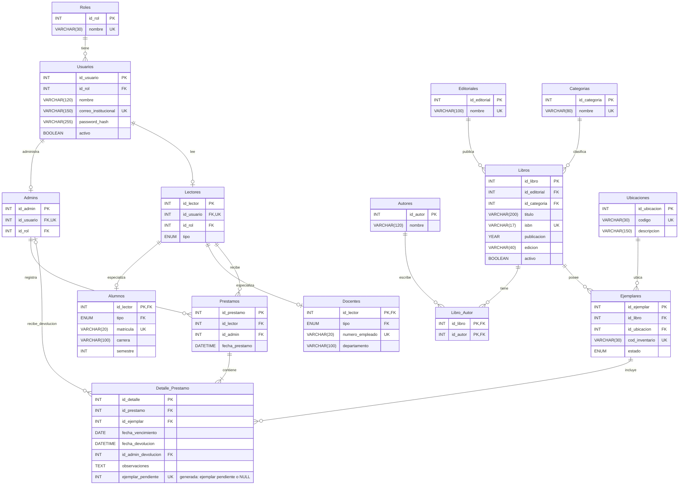

# BiblioApp

**Integrantes:**

- 24410172 - Miguel Ángel Ramírez Francisco
- 24410479 - Rocío Jaqueline Bordier Flores
- 24410663 - Axel Rodrigo Cisneros Cano

---

## 1. Idea General

BiblioApp es una aplicación web para administrar el catálogo, libros y  préstamos de una biblioteca académica. Está dirigida al personal de la biblioteca, alumnos y docentes.

Se ha detectado una dificultad para mantener un registro centralizado y actualizado. Algunos procesos aún se realizan mediante archivos separados, bases desactualizadas o fuera del acceso en línea útil hoy en día.

El objetivo del sistema es centralizar la información en una base de datos MySQL, facilitar el registro de préstamos y devoluciones y generar reportes que ayuden al personal a mantener un mejor control de la biblioteca.

El administrador registrará el identificador institucional de alumnos y maestros que permitirá distinguir su perfil dentro del sistema y podrán consultar sus préstamos e historial.

### 1.1 Alcance del Sistema
- Registrar y autenticar cuentas:
    - Administradores (personal)
    - Lectores (alumnos y maestros)
- Administrar la información de los libros: autores, editoriales, categorías, ubicaciones y ejemplares físicos.
- Consultar el catálogo y disponibilidad de los ejemplares.
- Registrar préstamos y devoluciones.
- Consultar préstamos e historial personal.
- Generar reportes parametrizables.

### 1.2 Delimitaciones
El sistema no incluirá: 
- Reservas 
- Renovaciones
- Multas o cobros
- Compras a proveedores
- Préstamos interbibliotecarios
- Libros digitales
- Notificaciones automáticas
- Aplicación móvil nativa.

Los préstamos serán registrados por el administrador durante la entrega presencial. No habrá autorregistro de cuentas.

Las fechas de vencimiento se establecerán al registrar cada préstamo. No se implementarán políticas establecidas por la institución.

## 2. Descripción de Tablas
Se integra la siguiente base de datos relacional compuesta por 15 tablas, normalizada hasta la Tercera Forma Normal (3FN):

| Tabla | Descripción y datos principales |
| --- | --- |
| `Roles` | Define el tipo de cuenta y permisos: Administrador y Lector. Contiene identificador y nombre único del rol. |
| `Usuarios` | Almacena nombre completo, correo institucional, hash de contraseña, estado activo/inactivo y referencia al rol. |
| `Admins` | Contiene la información específica del personal encargado de administrar la biblioteca. |
| `Lectores` | Identifica a los usuarios que pueden recibir préstamos. Cada lector se asocia con una cuenta única mediante `id_usuario`. |
| `Alumnos` | Extiende el perfil del lector con atributos de alumnos. `id_lector` será clave primaria y foránea. |
| `Docentes` | Extiende el perfil del lector con atributos de docentes. `id_lector` será clave primaria y foránea. |
| `Editoriales` | Registra las editoriales relacionadas con los libros del catálogo. |
| `Categorias` | Registra la clasificación principal de los libros. |
| `Autores` | Almacena los nombres de los autores que participan en las obras del catálogo. |
| `Libros` | Registra título, ISBN, año de publicación, edición, editorial, categoría y estado activo/inactivo. Cada registro representa una edición bibliográfica. |
| `Libro_Autor` | Auxiliar en la relación de muchos a muchos entre libros y autores. Su clave primaria compuesta evita repetir la misma asociación. |
| `Ubicaciones` | Registra los códigos y descripciones de estantes o secciones de la biblioteca. |
| `Ejemplares` | Registra cada copia física con código de inventario único, libro, ubicación y condición operativa: habilitado, mantenimiento o baja. |
| `Prestamos` | Almacena el lector, el administrador responsable del registro y la fecha y hora de la operación. |
| `Detalle_Prestamo` | Relaciona cada préstamo con sus ejemplares e incluye fecha de vencimiento, fecha y hora de devolución, administrador que recibe la devolución y observaciones. |

El script añade `matricula` en Alumnos y `numero_empleado` en Docentes. Las claves técnicas `id_rol` y `tipo` en los subtipos permiten comprobar coherencia con claves foráneas compuestas. Son campos de integridad, no roles nuevos.

### 2.1 Diagrama de Base de Datos
El siguiente diagrama muestra las 15 tablas y todos los campos físicos del script `biblioapp.sql`, incluidas las claves compuestas de integridad y la columna generada de ocupación. `Vista_Disponibilidad` es una vista derivada, no una tabla base.

**Figura 1**. *Diagrama Entidad-Relación de BiblioApp*



#### Restricciones

* Tabla **Admins**:
    * id_rol = 1. Solo podrán registrarse los usuarios cuyo id_rol sea igual a 1, correspondiente al rol de admin. Se garantiza con CHECK y FK compuesta. `Lectores.id_rol = 2`; `Alumnos.tipo = Alumno` y `Docentes.tipo = Docente`, también con CHECK y FK compuesta.
* Tabla **Detalle_Prestamo**:
    * Las fechas de devolución y el administrador que recibe se mantendrán nulos mientras el ejemplar no haya sido devuelto.

## 3. Tipos de Usuario (Roles)

BiblioApp manejará dos roles de acceso: Administrador y Lector. El rol Lector se especializa en dos tipos de perfil: Alumno y Maestro.

| Rol               | Acciones principales                                                                                                                                                                                                                                                              |
| ----------------- | --------------------------------------------------------------------------------------------------------------------------------------------------------------------------------------------------------------------------------------------------------------------------------- |
| **Administrador** | Iniciar sesión; administrar usuarios, lectores y cuentas; gestionar libros, autores, editoriales, categorías, ubicaciones y ejemplares; registrar préstamos y devoluciones; consultar la disponibilidad de ejemplares; consultar historiales; y generar reportes parametrizables. |
| **Alumno**        | Iniciar sesión con su correo institucional; consultar el catálogo de libros; consultar la disponibilidad de ejemplares; consultar sus préstamos activos y su historial de préstamos y devoluciones.                                                                        |
| **Docente**       | Iniciar sesión con su correo institucional; consultar el catálogo de libros; consultar la disponibilidad de ejemplares; consultar sus préstamos activos y su historial de préstamos y devoluciones.                                                                        |

Alumnos y docentes se diferencian por la información específica almacenada en sus perfiles.

Los préstamos y devoluciones serán gestionados por el **Administrador**, por lo que los alumnos y maestros no podrán registrar directamente estas operaciones.

## 4. Arquitectura
El sistema será desarrollado como una aplicación web, por lo que los usuarios podrán acceder mediante un navegador web sin necesidad de instalar una aplicación nativa en cada equipo.

Las tecnologías principales serán:

* **Frontend**: **HTML y CSS** para la creación de la interfaz y la interacción con el usuario.
* **Backend**: **PHP**, encargado de procesar las solicitudes, aplicar las reglas del sistema y comunicarse con la base de datos.
* **Servidor web**: **Apache**, encargado de recibir las solicitudes HTTP/HTTPS y servir la aplicación.
* **Base de datos**: **MySQL**, utilizada para almacenar y administrar la información de usuarios, lectores, libros, ejemplares, préstamos y devoluciones.
* **Entorno de desarrollo**: **Visual Studio Code** como editor de código y un entorno local basado en Apache, PHP y MySQL para el desarrollo y las pruebas del sistema.

### Módulos del Sistema

BiblioApp estará segmentado en los siguientes módulos:

| Módulo                  | Función principal                                                                                 |
| ----------------------- | ------------------------------------------------------------------------------------------------- |
| **Autenticación**       | Permitir el inicio de sesión y controlar el acceso según el rol del usuario.                      |
| **Usuarios y lectores** | Administrar las cuentas de usuarios, administradores, alumnos y maestros.                         |
| **Catálogo**            | Gestionar libros, autores, editoriales y categorías.                                              |
| **Ejemplares**          | Registrar las copias físicas, su ubicación, código de inventario y condición operativa.           |
| **Préstamos**           | Registrar los préstamos realizados por alumnos y maestros.                                        |
| **Devoluciones**        | Registrar la devolución de ejemplares, la fecha y hora y el administrador que recibe el material. |
| **Consultas**           | Permitir consultar el catálogo, disponibilidad, préstamos e historial personal.                   |
| **Reportes**            | Generar reportes parametrizables sobre libros, ejemplares, préstamos, devoluciones y usuarios.    |

## 5. Reportes
Los cuatro reportes serán generados por el administrador en formato PDF. Cada documento incluirá el nombre del sistema, título del reporte, fecha y hora de generación, parámetros aplicados, resultados, totales pertinentes y numeración de páginas. Cuando no existan coincidencias, el PDF indicará que no se encontraron registros para los filtros seleccionados.

Los reportes serán **parametrizables**, es decir, el administrador podrá seleccionar diferentes criterios o filtros antes de generarlos. El sistema utilizará estos parámetros para determinar qué información se incluirá en el reporte.

| ID     | Reporte                       | Parámetros                                                                                                                                                                                                              | Contenido                                                                                                                                                                                                                                                                                |
| ------ | ----------------------------- | ----------------------------------------------------------------------------------------------------------------------------------------------------------------------------------------------------------------------- | ---------------------------------------------------------------------------------------------------------------------------------------------------------------------------------------------------------------------------------------------------------------------------------------- |
| REP-01 | Préstamos realizados          | **Fecha inicial y fecha final:** obligatorias y aplicadas a la fecha del préstamo. **Tipo de lector:** todos, alumnos o maestros. **Lector específico:** opcional; permite seleccionar un alumno o maestro determinado. | Folio, fecha de préstamo, lector, tipo de perfil, identificador institucional, administrador que registra, libros y códigos de ejemplar. Incluye el total de préstamos y el total de ejemplares prestados por separado.                                                                  |
| REP-02 | Préstamos vencidos pendientes | **Tipo de lector:** todos, alumnos o maestros. **Categoría:** opcional. **Mínimo de días de atraso:** obligatorio, entero mayor o igual que 1, con valor inicial de 1.                                                  | Ejemplares pendientes cuya fecha de vencimiento sea anterior a la fecha actual y que no hayan sido devueltos. Incluye lector, identificador institucional, libro, código de ejemplar, fecha de vencimiento y días de atraso. Incluye el total de ejemplares vencidos.                    |
| REP-03 | Inventario de ejemplares      | **Categoría:** opcional. **Ubicación:** opcional. **Disponibilidad actual:** todos, disponibles, prestados o fuera de servicio.                                                                                         | Código de ejemplar, título, categoría, ubicación, condición operativa y disponibilidad calculada. Incluye totales por disponibilidad de acuerdo con los filtros seleccionados.                                                                                                           |
| REP-04 | Libros más solicitados        | **Fecha inicial y fecha final:** obligatorias y aplicadas a la fecha del préstamo. **Categoría:** opcional. **Tipo de lector:** todos, alumnos o maestros. **Cantidad máxima de resultados:** 5, 10 o 20.               | Ranking de libros según la cantidad de veces que sus ejemplares fueron incluidos en préstamos durante el periodo seleccionado. Incluye título, ISBN cuando exista y cantidad de ejemplares prestados. Los empates se ordenarán primero por título y después por identificador del libro. |

### Criterios de Parametrización y Cálculo

* **REP-01:** el administrador seleccionará un rango de fechas obligatorio. El sistema incluirá los préstamos cuya fecha se encuentre dentro del rango, considerando tanto la fecha inicial como la fecha final. Además, podrá filtrar por tipo de lector o seleccionar un lector específico.

* **REP-02:** el administrador podrá seleccionar el tipo de lector y, opcionalmente, una categoría. También establecerá el mínimo de días de atraso. El valor inicial será de **1 día**, por lo que únicamente se considerarán ejemplares cuya fecha de vencimiento sea anterior a la fecha actual y que permanezcan pendientes de devolución.

* **REP-03:** el administrador podrá seleccionar una categoría, una ubicación y el estado de disponibilidad que desea consultar. Todos estos filtros serán opcionales, por lo que podrá generar un reporte general del inventario o limitar los resultados a determinados ejemplares.

* **REP-04:** el administrador deberá indicar un periodo mediante una fecha inicial y una fecha final. De manera opcional, podrá seleccionar una categoría y el tipo de lector. Finalmente, elegirá si desea visualizar los **5, 10 o 20 libros** con mayor cantidad de ejemplares incluidos en préstamos durante el periodo seleccionado.

### Criterios Generales de Cálculo

* Los rangos de fechas incluirán **ambos días** y se rechazará el reporte si la fecha inicial es posterior a la fecha final.

* Los días de atraso se calcularán en **días calendario** respecto de la fecha actual configurada en el servidor. Un ejemplar cuya fecha de vencimiento sea el día actual no se considerará vencido.

* En **REP-04** se contará cada ejemplar incluido en un préstamo como una ocurrencia. Las devoluciones no eliminarán la operación del conteo histórico.

* Para **REP-03**, un ejemplar estará **prestado** si tiene un detalle de préstamo sin devolución. Estará **disponible** si no tiene un préstamo pendiente, su condición operativa es **habilitado** y su libro se encuentra activo. En los demás casos estará **fuera de servicio**.

* **REP-02 y REP-03** reflejarán la situación existente al momento de generar el reporte; no reconstruirán inventarios ni atrasos correspondientes a fechas pasadas.

* Cuando un reporte no encuentre registros que coincidan con los parámetros seleccionados, el PDF mostrará un mensaje indicando que **no se encontraron registros para los filtros seleccionados**.


## 6. Requerimientos Funcionales

Los requerimientos funcionales de BiblioApp describen las acciones que el sistema deberá realizar para cumplir con el alcance definido. Cada requerimiento identifica el módulo al que pertenece, el rol que interviene, las reglas principales y su prioridad.

**Roles:** Para simplificar la descripción, el rol **Lector** comprende tanto a **Alumnos** como a **Maestros**.

| ID | Módulo | Nombre | Rol principal | Descripción del requerimiento | Prioridad  Criterios de aceptación | Validación / excepción |
| --- | --- | --- | --- | --- | --- | --- | --- |
| **RF-01** | Seguridad | **Autenticar usuario** | Administrador, Lector | El sistema permitirá iniciar sesión mediante correo institucional único y contraseña. Validará que las credenciales sean correctas y que la cuenta se encuentre activa. Después de una autenticación válida, mostrará las funciones correspondientes al rol del usuario. | Imprescindible |  Credenciales activas de administrador, alumno y docente redirigen a su panel; el rol se obtiene de MySQL y se regenera la sesión. | Correo mal formado o campos vacíos: no autentica. Contraseña incorrecta, correo inexistente, cuenta inactiva o perfil incompleto: mensaje genérico y sin sesión. |
| **RF-02** | Seguridad | **Cerrar sesión** | Administrador, Lector | El sistema permitirá cerrar la sesión activa y requerirá una nueva autenticación para acceder nuevamente a las funciones protegidas. | Imprescindible |  Cerrar sesión mediante POST destruye la sesión y cookie; volver a una URL protegida exige autenticación. | GET en logout: 405. Token CSRF ausente o inválido: 403. La página protegida no se almacena en caché. |
| **RF-03** | Seguridad | **Autorizar operaciones** | Administrador, Lector | El sistema verificará el rol del usuario antes de ejecutar cada operación protegida. Los lectores no podrán acceder a funciones administrativas ni consultar información perteneciente a otros lectores. | Imprescindible |  Cada ruta verifica la sesión y el perfil contra MySQL; los lectores acceden exclusivamente a su información. | Sin sesión: redirección al login. Alumno o docente entrando a otro panel: 403. No se acepta un rol o id de lector enviado por el navegador. |
| **RF-04** | Usuarios y lectores | **Registrar administrador** | Administrador | El sistema permitirá registrar una cuenta administrativa proporcionando nombre completo, correo institucional único y contraseña. La primera cuenta administrativa será creada durante la instalación del sistema. | Imprescindible |  El administrador crea cuenta y perfil administrativo juntos, con nombre, correo único y hash de contraseña; la instalación incluye cuentas base. | Correo duplicado o inválido, nombre vacío o contraseña fuera de 12 a 72 bytes: rechaza y revierte toda la operación. |
| **RF-05** | Usuarios y lectores | **Registrar alumno** | Administrador | El sistema permitirá registrar un alumno proporcionando nombre completo, correo institucional, contraseña, identificador de alumno, carrera y semestre. El correo y el identificador de alumno deberán ser únicos. | Imprescindible |  Crea cuenta, lector y alumno en una transacción; matrícula única, carrera y semestre entre 1 y 16 son obligatorios. | Correo o matrícula duplicados, carrera vacía o semestre fuera de rango: rechaza sin registros parciales. |
| **RF-06** | Usuarios y lectores | **Registrar maestro** | Administrador | El sistema permitirá registrar un maestro proporcionando nombre completo, correo institucional, contraseña, identificador de docente y departamento. El correo y el identificador de docente deberán ser únicos. | Imprescindible |  Crea cuenta, lector y docente en una transacción; número de empleado único y departamento son obligatorios. | Correo o número de empleado repetidos o departamento vacío: rechaza sin registros parciales. |
| **RF-07** | Usuarios y lectores | **Validar perfil de lector** | Administrador | El sistema garantizará que cada lector tenga un único perfil especializado: alumno o maestro. No permitirá asociar simultáneamente ambos perfiles ni convertir un lector en administrador desde la gestión de perfiles. | Imprescindible |  Cada lector tiene exactamente una especialización acorde con su tipo; no puede tener perfil administrativo. | Intento de asociar ambos subtipos: rechaza mediante claves compuestas. Perfil faltante: no permite autenticar; futuras altas deberán confirmar todos los registros en una transacción. |
| **RF-08** | Usuarios y lectores | **Consultar y modificar usuarios** | Administrador | El sistema permitirá localizar usuarios mediante nombre, correo o identificador escolar, filtrar lectores por tipo y modificar sus datos. Las modificaciones deberán conservar las restricciones de unicidad de los identificadores y correos. | Imprescindible |  La búsqueda por nombre, correo o identificador devuelve coincidencias y la modificación conserva PK y relaciones. | Sin coincidencias: lista vacía. Correo o identificador ya ocupado: no guarda cambios. Campos obligatorios inválidos: señala el error. |
| **RF-09** | Usuarios y lectores | **Activar o desactivar cuentas** | Administrador | El sistema permitirá activar o desactivar cuentas sin eliminar su historial. Una cuenta inactiva no podrá iniciar sesión ni recibir nuevos préstamos. El sistema permitirá registrar la devolución de préstamos pendientes de una cuenta inactiva y evitará desactivar al último administrador activo. | Imprescindible |  Desactivar conserva historial e impide login y nuevos préstamos; se permite devolver pendientes. Siempre queda al menos un administrador activo. | Intento de desactivar al último administrador activo: rechaza dentro de transacción. Dos desactivaciones concurrentes se serializan con bloqueo. |
| **RF-10** | Usuarios y lectores | **Consultar perfil propio** | Lector | El sistema permitirá al lector consultar su nombre, correo institucional, tipo de perfil e identificador escolar. Los alumnos visualizarán además carrera y semestre, mientras que los maestros visualizarán su departamento. El lector no podrá modificar su rol ni identificador institucional. | Imprescindible |  Alumno ve matrícula, carrera y semestre; docente ve número de empleado y departamento; ambos ven nombre y correo propios. | Cambiar identificador en URL no cambia el usuario consultado. No hay formulario para alterar rol o identificador. |
| **RF-11** | Catálogo | **Administrar catálogos bibliográficos** | Administrador | El sistema permitirá registrar, consultar, modificar y eliminar autores, editoriales y categorías. Solo permitirá eliminar registros que no tengan libros relacionados. | Imprescindible |  Permite altas, consultas, modificaciones y bajas de autores, editoriales y categorías con nombres no vacíos. | Editorial o categoría repetida: rechaza. Catálogo referenciado por libros: impide borrar mediante FK y muestra mensaje. |
| **RF-12** | Catálogo | **Registrar y modificar libros** | Administrador | El sistema permitirá registrar y modificar libros indicando título, editorial, categoría y al menos un autor. Podrá incluir año de publicación, edición e ISBN. El ISBN deberá ser único cuando sea proporcionado y no se aceptarán cadenas vacías como valor. | Imprescindible |  Guarda título, editorial y categoría existentes y al menos un autor distinto; ISBN opcional se normaliza a NULL cuando no se informa. | ISBN repetido o vacío explícito, autor inexistente o ausencia de autores: rechaza la transacción. Año opcional debe ser compatible con YEAR de MySQL. |
| **RF-13** | Catálogo | **Desactivar libros** | Administrador | El sistema permitirá desactivar un libro sin eliminar sus ejemplares ni su historial de préstamos. No permitirá desactivar un libro mientras alguno de sus ejemplares tenga un préstamo pendiente. | Imprescindible |  Libro sin préstamos pendientes se desactiva conservando ejemplares y registros históricos. | Si tiene cualquier ejemplar sin devolución: rechaza la desactivación; lectores dejan de verlo cuando se desactiva. |
| **RF-14** | Catálogo | **Consultar catálogo y disponibilidad** | Administrador, Lector | El sistema permitirá buscar libros mediante título, autor o ISBN, filtrar por categoría y consultar sus datos y disponibilidad. Los lectores solo visualizarán libros activos. | Imprescindible |  Busca por título, autor o ISBN y filtra categoría; disponibilidad distingue disponible, prestado y fuera de servicio. | Sin resultados: mensaje claro. Lector no ve libros inactivos. Un préstamo pendiente tiene prioridad sobre condición operativa al calcular disponibilidad. |
| **RF-15** | Ejemplares | **Administrar ubicaciones** | Administrador | El sistema permitirá registrar, consultar y modificar ubicaciones indicando código único y descripción. No permitirá eliminar una ubicación mientras existan ejemplares asociados a ella. | Imprescindible |  Registra y modifica código único no vacío y descripción de una ubicación. | Código repetido o descripción vacía: rechaza. Una ubicación con ejemplares no se elimina. |
| **RF-16** | Ejemplares | **Registrar y modificar ejemplares** | Administrador | El sistema permitirá registrar cada ejemplar mediante código de inventario único, libro, ubicación y condición operativa. También permitirá modificar su ubicación y condición. No permitirá cambiar de libro un ejemplar que tenga historial de préstamos. | Imprescindible |  Cada copia tiene código único, libro y ubicación existentes y condición válida; permite actualizar ubicación. | Código duplicado o referencia inexistente: rechaza. Cambiar de libro con historial de préstamos: impide la operación. |
| **RF-17** | Ejemplares | **Modificar condición operativa** | Administrador | El sistema permitirá establecer la condición de un ejemplar como habilitado, mantenimiento o baja. No permitirá establecer mantenimiento o baja mientras exista un préstamo pendiente y conservará el historial de los ejemplares dados de baja. | Imprescindible |  Acepta habilitado, mantenimiento o baja; conserva préstamos históricos tras la baja. | Con préstamo pendiente no permite mantenimiento ni baja. Valor fuera del catálogo: rechaza. |
| **RF-18** | Préstamos | **Identificar lector** | Administrador | El sistema permitirá seleccionar el tipo de lector y localizarlo mediante identificador de alumno, identificador de docente o nombre. Antes de registrar el préstamo mostrará sus datos y préstamos pendientes. | Imprescindible |  Permite buscar por perfil e identificador o nombre; muestra datos y pendientes del lector elegido antes de confirmar. | Sin coincidencias: no habilita préstamo. Nombres iguales requieren seleccionar identificador; cuenta inactiva se señala y no admite préstamo. |
| **RF-19** | Préstamos | **Registrar préstamo** | Administrador | El sistema permitirá registrar uno o varios ejemplares distintos para un lector activo. Asignará un folio, el administrador responsable y la fecha y hora de registro. Cada ejemplar deberá tener una fecha de vencimiento igual o posterior a la fecha del préstamo. | Imprescindible |  Guarda folio, lector activo, administrador autenticado, fecha y uno o más ejemplares distintos en transacción. | Lista vacía, ejemplar repetido o fecha de vencimiento anterior al día de préstamo: rechaza todo y no genera préstamo parcial. |
| **RF-20** | Préstamos | **Validar disponibilidad de ejemplares** | Administrador | El sistema impedirá prestar ejemplares que tengan un préstamo pendiente, se encuentren en mantenimiento o de baja, o pertenezcan a libros inactivos. Si alguno de los ejemplares seleccionados no cumple las condiciones, no registrará parcialmente la operación. | Imprescindible |  Bloquea ejemplares seleccionados y comprueba libro activo, condición habilitada y ausencia de préstamo pendiente antes de confirmar. | Si un ejemplar falla revierte todo. Dos solicitudes concurrentes por la misma copia: solo una puede confirmar; índice único protege la ocupación pendiente. |
| **RF-21** | Préstamos | **Consultar préstamos** | Administrador | El sistema permitirá consultar préstamos y sus detalles mediante filtros de periodo, lector, tipo de lector y estado: pendiente, parcialmente devuelto o concluido. También permitirá identificar detalles vencidos que aún no hayan sido devueltos. | Imprescindible |  Filtros de periodo, lector, tipo y estado devuelven detalles correctos; clasifica pendiente, parcial y concluido por devoluciones. | Rango invertido: rechaza. Ninguna coincidencia: lista vacía. Vencido solo si la fecha de vencimiento es anterior a hoy y sigue pendiente. |
| **RF-22** | Préstamos | **Consultar préstamos e historial propios** | Lector | El sistema permitirá al lector consultar exclusivamente sus propios préstamos, mostrando libro, ejemplar, fecha de préstamo, fecha de vencimiento, fecha de devolución y aviso cuando exista un atraso pendiente. | Imprescindible |  Muestra exclusivamente los préstamos del lector autenticado con fechas, ejemplar y aviso de vencimiento pendiente. | Lector sin préstamos ve estado vacío. Ni URL ni parámetros permiten consultar otro lector. Un detalle devuelto deja de aparecer como vencido pendiente. |
| **RF-23** | Devoluciones | **Registrar devolución de ejemplar** | Administrador | El sistema permitirá localizar un detalle de préstamo pendiente mediante folio o código de ejemplar y registrar su devolución indicando fecha y hora, administrador receptor y observaciones opcionales. La devolución de un ejemplar no finalizará los demás detalles pendientes del mismo préstamo. | Imprescindible |  Localiza un detalle pendiente y guarda fecha/hora y administrador receptor; los demás detalles del folio permanecen pendientes. | Folio inexistente o sin pendientes: informa sin cambios. No admite una fecha de devolución anterior al préstamo. |
| **RF-24** | Devoluciones | **Validar devolución y condición** | Administrador | El sistema impedirá registrar dos veces la devolución del mismo ejemplar y permitirá establecer la condición resultante como habilitado, mantenimiento o baja. La devolución y la condición resultante deberán registrarse como una sola operación. | Imprescindible |  Actualiza devolución y condición del ejemplar en una transacción con bloqueo del detalle. | Doble envío o devolución ya registrada: no duplica. Condición inválida o fallo SQL: revierte devolución y condición. |
| **RF-25** | Reportes | **Generar reporte de préstamos realizados** | Administrador | El sistema permitirá generar el **REP-01** en PDF mediante fecha inicial y final obligatorias, tipo de lector y lector específico opcional. El reporte incluirá los datos y totales definidos para los préstamos realizados. | Imprescindible |  REP-01 PDF incluye filtros, folios y totales separados de préstamos y ejemplares; fechas inclusivas. | Rango ausente o invertido, o lector incompatible con el tipo seleccionado: rechaza. Sin datos: PDF con mensaje y totales cero. |
| **RF-26** | Reportes | **Generar reporte de préstamos vencidos** | Administrador | El sistema permitirá generar el **REP-02** en PDF mediante tipo de lector, categoría opcional y mínimo de días de atraso. El reporte incluirá únicamente ejemplares vencidos que permanezcan pendientes de devolución. | Imprescindible |  REP-02 incluye solo pendientes vencidos y calcula días calendario respecto a la fecha del servidor. | Mínimo de atraso no entero o menor que 1: rechaza. Vencimiento hoy o devolución existente: excluye. |
| **RF-27** | Reportes | **Generar reporte de inventario de ejemplares** | Administrador | El sistema permitirá generar el **REP-03** en PDF mediante categoría opcional, ubicación opcional y disponibilidad actual: todos, disponibles, prestados o fuera de servicio. | Imprescindible |  REP-03 aplica categoría, ubicación y disponibilidad y totaliza resultados por estado actual. | Valores de filtro inexistentes: rechaza. Sin coincidencias: PDF vacío con mensaje. Libro inactivo sin préstamo pendiente: fuera de servicio. |
| **RF-28** | Reportes | **Generar reporte de libros más solicitados** | Administrador | El sistema permitirá generar el **REP-04** en PDF mediante fecha inicial y final obligatorias, categoría opcional, tipo de lector y cantidad máxima de resultados de 5, 10 o 20 libros. El reporte ordenará los libros según la cantidad de ejemplares incluidos en préstamos durante el periodo seleccionado. | Imprescindible |  REP-04 cuenta cada detalle prestado en el periodo, limita a 5, 10 o 20 y desempata por título e id. | Límite no permitido o rango invertido: rechaza. Devoluciones no restan del conteo; sin datos: mensaje en PDF. |
| **RF-29** | Reportes | **Validar parámetros y generar PDF** | Administrador | El sistema validará los parámetros antes de generar cada reporte. Rechazará rangos donde la fecha inicial sea posterior a la fecha final y permitirá descargar el PDF con los parámetros utilizados. Cuando no existan coincidencias, el documento indicará que no se encontraron registros para los filtros seleccionados. | Imprescindible |  Todo PDF incluye nombre del sistema, título, fecha/hora, filtros, resultados, totales y páginas; solo administrador puede descargarlo. | Filtros inválidos: no genera PDF. Sin sesión: login; lector: 403. Sin coincidencias: documento válido con mensaje. |
| **RF-30** | Panel administrativo | **Mostrar indicadores generales** | Administrador | El sistema mostrará en el panel administrativo la cantidad actual de ejemplares disponibles, ejemplares prestados y ejemplares vencidos pendientes. | Deseable |  Panel administrativo consulta MySQL y muestra disponibles, prestados y vencidos pendientes, coherentes con los detalles. | Inventario vacío: indicadores cero. Caída de MySQL: 503 sin credenciales ni SQL expuestos. |

## 7. Primer avance: alcance implementado

Esta entrega conserva el alcance de la propuesta corregida. No se recibieron observaciones adicionales del docente para esta actualización. Se corrigió la cantidad real de tablas (15), se unificó el correo institucional como identificador de login y se incorporaron los identificadores de alumno y docente al esquema físico y al ER. El alta de cuentas corresponde al administrador; no hay autorregistro.

| Componente | Estado de este avance |
| --- | --- |
| RF-01, RF-02 y RF-03 | Implementados: login real por MySQL, logout y autorización en el servidor. |
| RF-10 y RF-22 | Implementados: perfil e historial propios de alumnos y docentes. |
| RF-30 | Implementado: indicadores administrativos consultados en MySQL. |
| Base de datos | Implementada: 15 tablas InnoDB, PK, FK, UNIQUE, CHECK, vista de disponibilidad y DML ficticio. |
| RF-04 a RF-09, RF-11 a RF-21, RF-23 a RF-29 | Especificados con aceptación y excepciones; las interfaces y servicios de gestión completos quedan para siguientes avances. Las cuentas base se incluyen por SQL. |
| Video de YouTube | **Pendiente de grabación y publicación por el equipo. No existe todavía un enlace de entrega.** |

Los criterios de la sección 6 describen el sistema objetivo; esta tabla distingue lo implementado de lo previsto. Las reglas entre múltiples registros (al menos un autor por libro, creación completa de perfil, detalle por préstamo, transacciones de préstamo/devolución y último administrador activo) deberán cumplirse en los servicios futuros. La base asegura referencias, unicidad y coherencia de subtipos; no implementa por sí sola todas las reglas del sistema.

### 7.1 Estructura del repositorio

```text
readme.md                    Propuesta, RF, criterios, ER e instalación
biblioapp.sql                DDL y DML completos (15 tablas)
.gitignore                  Exclusión de configuración privada y temporales
codigo/
  .env.example              Plantilla sin credenciales reales
  config/Database.php       Único punto de conexión PDO
  src/Auth.php              Login, perfiles, permisos y sesión
  src/bootstrap.php         Inicialización, CSRF y manejo de errores
  src/views.php             Presentación compartida y portal del lector
  public/                   Único directorio expuesto por el servidor web
    index.php               Login
    admin.php               Panel del administrador
    alumno.php              Panel del alumno
    docente.php             Panel del docente
    logout.php              Cierre de sesión por POST
    assets/app.css          Interfaz adaptable
  tests/                    Pruebas reproducibles
docs/                       Guion de video y evidencia de validación
```

### 7.2 Instalación local

Requisitos: MySQL **8.0.16+** (para CHECK), PHP **8.2+** con `pdo_mysql` y un navegador. Puede usarse Apache; para la demostración local basta el servidor integrado de PHP. No usar el servidor integrado como despliegue público.

1. Clonar este repositorio y abrir una terminal en su raíz.
2. Desde el cliente clásico `mysql`, conectado con una cuenta con permiso para crear bases, ejecutar el script sobre una instalación nueva:

   ```sql
   SOURCE C:/ruta/BiblioApp/biblioapp.sql;
   ```

   Ajustar la ruta y usar `/` en Windows. El script crea `biblioapp`; no contiene `DROP DATABASE` ni reemplaza información existente. Si esa base ya existe, detenerse y elegir una instancia nueva para pruebas; no reimportar encima. Las fechas de prueba son relativas al momento de la importación.

3. Crear un usuario de aplicación local con una contraseña elegida en el equipo. Para las funcionalidades de este avance solo requiere SELECT:

   ```sql
   CREATE USER 'biblioapp_app'@'127.0.0.1' IDENTIFIED BY 'REEMPLAZAR_POR_CLAVE_LOCAL';
   GRANT SELECT ON biblioapp.* TO 'biblioapp_app'@'127.0.0.1';
   ```

4. En PowerShell copiar la plantilla y editar **localmente** `codigo/.env` con host, puerto, usuario y contraseña reales:

   ```powershell
   Copy-Item codigo/.env.example codigo/.env
   notepad codigo/.env
   ```

   Si el valor contiene espacios, `;` o `#`, encerrarlo entre comillas dobles según el formato INI. El `.env` está excluido por Git y debe quedar fuera de la raíz pública. No subirlo ni mostrarlo en el video.

5. Desde la raíz del repositorio:

   ```powershell
   php -S 127.0.0.1:8087 -t codigo/public
   ```

6. Abrir <http://127.0.0.1:8087>. En Apache configurar el DocumentRoot a `codigo/public`, nunca a la raíz del repositorio ni a `codigo`.

### 7.3 Cuentas ficticias de demostración

Todas usan la contraseña **`BibliotecaDemo2026!`**, almacenada como hash bcrypt, nunca como texto en la tabla. Son datos de prueba públicos y exclusivos de una instalación local; reemplazarlos antes de cualquier despliegue.

| Correo | Rol / perfil | Resultado esperado |
| --- | --- | --- |
| admin@biblioapp.test | Administrador | Panel administrativo e indicadores. |
| auxiliar@biblioapp.test | Administrador | Segundo administrador de prueba. |
| alumno@biblioapp.test | Lector / Alumno | Matrícula, carrera, semestre e historial propio. |
| docente@biblioapp.test | Lector / Docente | Número de empleado, departamento e historial propio. |
| sinprestamos@biblioapp.test | Lector / Alumno | Perfil válido y estado sin préstamos. |
| inactivo@biblioapp.test | Lector / Alumno inactivo | Login rechazado. |

Datos base: 2 roles, 6 cuentas, 2 administradores, 4 lectores (3 alumnos y 1 docente), 3 editoriales, 3 categorías, 4 autores, 5 libros, 6 asociaciones libro-autor, 3 ubicaciones, 10 ejemplares, 3 préstamos y 4 detalles. Hay un préstamo parcialmente devuelto, uno pendiente vigente y uno concluido. Al importar: 5 ejemplares disponibles, 2 prestados, 3 fuera de servicio y 1 vencido pendiente. Los vencimientos se recalculan con el paso de los días.

### 7.4 Conexión y controles de acceso

`Database::connection()` en `codigo/config/Database.php` es el único creador de PDO. Lee `codigo/.env`, usa `utf8mb4`, excepciones y consultas preparadas nativas. `Auth` utiliza esa conexión y `password_verify()`; nunca compara contraseñas en texto ni permite elegir un rol en el formulario. Se regenera el identificador de sesión al autenticar. Cada petición protegida vuelve a comprobar el usuario activo y su perfil contra MySQL. El servidor impide acceder a paneles ajenos con 403 y filtra préstamos por el lector de la sesión.

El cierre de sesión usa POST y token CSRF; las cookies usan HttpOnly, SameSite=Lax y Secure cuando se sirve con HTTPS. Los errores de configuración o de BD devuelven 503 sin mostrar credenciales ni consultas. Para producción quedan pendientes, entre otros, HTTPS configurado, límites persistentes de intentos y gestión segura de cuentas.

### 7.5 Validación reproducible

Con el servidor y MySQL iniciados:

```powershell
python codigo/tests/http_smoke.py --base http://127.0.0.1:8087
```

Usa solo la biblioteca estándar de Python y las cuentas ficticias del script. Comprueba login de los tres perfiles, aislamiento entre paneles e historiales, entrada inválida, inactivos, CSRF y logout. No modifica la base de datos. Los resultados de esta entrega se documentan en [docs/validacion-avance1.md](docs/validacion-avance1.md).

## 8. Video del primer avance

**Estado: pendiente.** El equipo indicó que todavía no está grabado. Falta publicar un video en YouTube de máximo 10 minutos y sustituir este estado por su enlace real y accesible. Esta parte del requisito aún no está cumplida.

Guion de grabación: [docs/guion-video.md](docs/guion-video.md). Debe incluir narración del equipo, login contra MySQL, demostración de administrador, alumno y docente, rechazo de credenciales inválidas y explicación de `Database::connection()` sin revelar `.env`.

## 9. Control de versiones y entrega

Etiqueta exigida: **`v0.1-avance1`**, sobre el último commit del avance en `main`. El historial se conserva; los cambios se registran por componente. La contribución equitativa debe corresponder a trabajo real de Miguel, Rocío y Axel: no se simulan autores ni commits retrospectivos. Antes de la entrega definitiva, cada integrante deberá aportar y revisar cambios desde su cuenta.

```powershell
git switch main
git push origin main
git tag -a v0.1-avance1 -m "Primer avance del proyecto"
git push origin v0.1-avance1
git ls-remote --tags origin v0.1-avance1
```

El equipo debe completar el video y revisar la participación antes de entregar el enlace del repositorio en la plataforma. No mover o reemplazar una etiqueta existente sin acuerdo del equipo; los cambios posteriores quedan fuera de la captura original.
